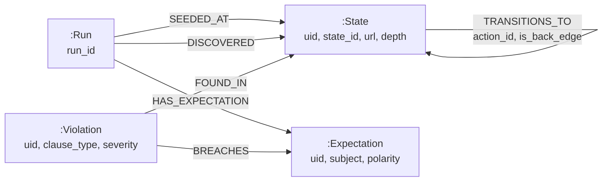

# Neo4j — the exploration graph

The primary store. Everything a report needs lives here; Redis and SQLite exist
only to make a *running* crawl work.

**Owner: Track D.** This is a proposal from Track B, written because the
orchestrator is the thing that produces these writes and the shapes have to line
up with `apps/agent/contracts.py`. Track D owns the driver, the transaction
boundaries, and any deviation from what is written here.

## The model



The `TRANSITIONS_TO` self-reference is the whole point: **the graph is cyclic**.
A back-edge is recorded, never pruned.

## Nodes

### `:Run`

One crawl. Immutable once `status` reaches `completed` or `failed`.

| Property | Type | Req | Notes |
| --- | --- | --- | --- |
| `run_id` | string | ✔ | Unique. From `OrchestratorConfig.new_run_id()` |
| `target_url` | string | ✔ | The seed |
| `role` | string | ✔ | One role per run (ADR-001 decision 5) |
| `status` | string | ✔ | `queued` \| `running` \| `stopping` \| `completed` \| `failed` |
| `started_at` | datetime | ✔ | |
| `finished_at` | datetime | | Null while running |
| `termination_reason` | string | | `frontier_exhausted` \| `depth_limit` \| `max_states` \| `stopped` \| `error` |
| `depth_limit`, `max_states` | int | ✔ | Config snapshot — a resumed run must not silently change rules |
| `state_count`, `edge_count`, `violation_count`, `skipped_count` | int | | Denormalised for the run list; recomputable |
| `replay_steps` | int | | Actions re-fired for re-navigation. The cost of breadth |
| `perception_mode` | string | | `full` \| `dom_only_smoke_test` (ADR-001 decision 7) |
| `git_sha` | string | | Which build produced this |

`termination_reason` is the field a reader must check before trusting coverage.
Only `frontier_exhausted` means the crawl finished; the rest mean it was cut off.

### `:State`

One distinct UI state, scoped to one run.

| Property | Type | Req | Notes |
| --- | --- | --- | --- |
| `uid` | string | ✔ | `"<run_id>:<state_id>"`. Unique. See "Run scoping" |
| `run_id` | string | ✔ | |
| `state_id` | string | ✔ | The fingerprint. **Shared across runs** — the join key |
| `url` | string | ✔ | Not an identity. An SPA shows many states at one URL |
| `title` | string | | |
| `role` | string | ✔ | Denormalised from the run; makes role queries index-only |
| `depth` | int | ✔ | Depth at **first** discovery. Never rewritten on revisit |
| `screenshot_path` | string | | Empty in DOM-only mode |
| `first_seen_at` | datetime | ✔ | |

### `:Expectation`

One policy clause, as extracted from the QA engineer's English.

| Property | Type | Req | Notes |
| --- | --- | --- | --- |
| `uid` | string | ✔ | `"<run_id>:<expectation_id>"` |
| `expectation_id`, `run_id` | string | ✔ | |
| `polarity` | string | ✔ | `must_exist` \| `must_not_exist` |
| `subject` | string | ✔ | The element or capability the clause is about |
| `roles` | list\<string\> | | Empty means every role |
| `source_text` | string | ✔ | The original sentence, so a report can quote it back |

Clauses are stored **per run** on purpose. The policy can change between runs,
and a report has to show the policy that was actually applied, not today's.

### `:Violation`

| Property | Type | Req | Notes |
| --- | --- | --- | --- |
| `uid` | string | ✔ | `"<run_id>:<violation_id>"` |
| `violation_id`, `run_id` | string | ✔ | |
| `clause_type` | string | ✔ | `forbidden_present` (FR-18) \| `required_absent` (FR-19) |
| `severity` | string | ✔ | `low` \| `medium` \| `high` \| `critical` |
| `rationale` | string | ✔ | Plain language, for the human |
| `selector`, `evidence_text`, `screenshot_path` | string | | Evidence. Empty for `required_absent` — there is no element to point at |
| `detected_at` | datetime | ✔ | |

### `:Control` — derived, optional

`action_id` is a content hash of role + accessible name + normalised selector, so
the same "Log out" button carries one id on every page (ADR-001 decision 1). A
`:Control` node makes that queryable: *"show me every state exposing this
control."*

**Built by a post-run projection, never on the write path.** The crawl is already
paying for re-navigation; it should not also pay for analytics writes it does not
read. See `../queries.cypher` → "Build the control projection".

## Run scoping — the decision to read before implementing

`state_id` is a content hash, so **the same page in two runs produces the same
fingerprint**. Keying `:State` on `state_id` alone would silently merge runs: a
second crawl would inherit the first one's nodes, and a guest run and an admin
run would fight over the same records.

So the unique key is `uid = "<run_id>:<state_id>"`, and `state_id` is kept as an
indexed property. That gives both:

- **Isolation** — two runs never touch each other's nodes.
- **Comparison** — join two runs on `state_id` to answer *"what does the guest
  see that the admin does not"* (FR-31), which is a reporting concern, not a
  crawl-layer one.

This is the storage-side answer to a defect found in M2-P2: two LangGraph threads
sharing one `GraphPort` inherited each other's visited set. Thread isolation is
not run isolation; `uid` is.

> **Community-edition constraint.** A composite node key would be the natural
> expression of this and is Enterprise-only. `uid` is a single-property
> uniqueness constraint, which Community enforces. It is a workaround, and it is
> the reason `run_id` is also stored separately — never parse `uid`.

## What the orchestrator writes, and when

Ordering is fixed by ADR-001 decision 3 and is not Track D's to rearrange:

```
mark_visited(state, action)   → Redis, BEFORE the action     (at-most-once)
crawler.act(action)           → the application under test
persist_edge(edge)            → Neo4j, AFTER it succeeds
persist_state(state)          → Neo4j, first visit only
persist_violation(v)          → Neo4j, first visit only
```

A crash between `mark_visited` and `persist_edge` leaves a claimed pair with no
edge. That is **intended**: resume treats it as done-but-unrecorded and logs it,
rather than re-firing an action the target app may not be idempotent about. The
graph will therefore occasionally be missing an edge for a claimed pair, and that
is not corruption.

`persist_state` is an upsert keyed on `uid` where **first write wins for `depth`**
— a cycle revisits a state at greater depth, and letting the later write through
would make `depth_limit` meaningless.

`persist_edge` **never deduplicates**. Two traversals of the same transition are
two facts.

## Mapping to `contracts.py`

| Contract type | Node | Notes |
| --- | --- | --- |
| `StateNode` | `:State` | Plus `uid`, `run_id` |
| `StateEdge` | `:TRANSITIONS_TO` | A relationship, not a node |
| `ExpectationNode` | `:Expectation` | |
| `Violation` | `:Violation` | `Evidence` flattened into three properties |
| `Action` | relationship properties (+ optional `:Control`) | |
| — | `:Run` | No contract equivalent; the API owns run lifecycle |

`Evidence` is flattened rather than given its own node: it is a value object with
no identity and is never queried independently.

## Retention

Nothing here deletes itself. A crawl of a large app is thousands of nodes, and
runs accumulate. Track D should decide a retention policy before the first real
target — `docs/db/README.md` sketches one.
