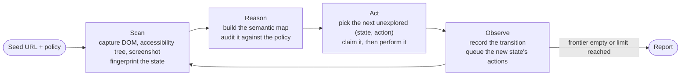
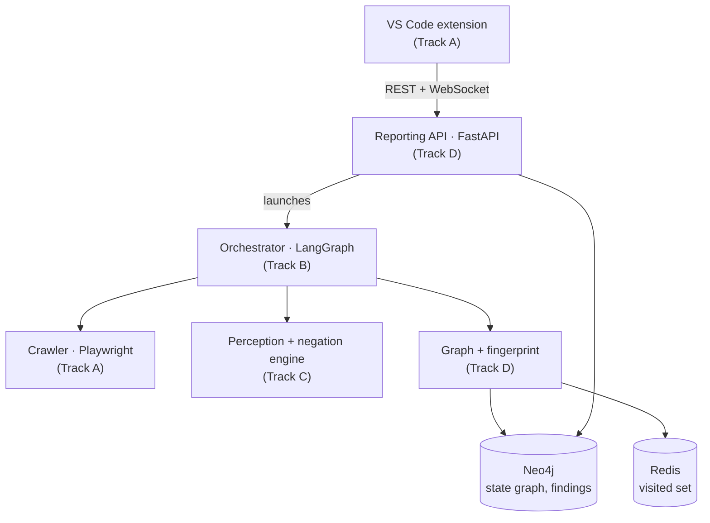

# Methodology

## The exploration loop

StateScout's orchestrator runs a **Scan → Reason → Act → Observe** loop over a
breadth-first frontier, implemented as a LangGraph state machine so every step is
checkpointed.

| Step | What happens | Owned by |
| --- | --- | --- |
| **Scan** | Playwright opens the page and captures the DOM, the accessibility tree and a screenshot. The capture is reduced to a SHA-256 **fingerprint** after normalising away per-request noise (session ids, CSRF tokens, timestamps, URL fragments). Equal fingerprints mean the same UI state. | Track A (capture), Track D (fingerprint) |
| **Reason** | Perception turns the capture into a **semantic map** - the elements and capabilities a user in this role can see. The negation engine audits it against the policy. | Track C |
| **Act** | The next action is taken from the frontier. Its `(state, action)` pair is marked visited **before** it runs, so a crash can never fire it twice. | Track B, Track D (visited set) |
| **Observe** | The transition is recorded as an edge, back-edges included, and the new state's actions join the frontier. | Track B, Track D (graph) |

The crawl stops when the frontier is empty, or at a configured depth or state
limit - and records which, so a reader knows whether coverage is complete.

## The negation engine

The policy becomes two sets of clauses. The audit is plain set algebra over the
semantic map `S` of each state:

> **violations = (S ∩ forbidden) ∪ (required ∖ S)**

- **Forbidden present (FR-18):** an element the policy forbids for this role is in
  the state.
- **Required absent (FR-19):** an element the policy requires is missing.

Vision-language models are unreliable at noticing that something is **absent**.
StateScout therefore decides presence and absence deterministically, from the DOM
and accessibility tree; the model only contributes semantic tags on top of the
elements that are there. It never adds or removes elements.

## The state graph is cyclic

The exploration graph is a **cyclic directed graph**, not a tree and not a DAG.
Logging out returns to the login page; *Back* returns to the dashboard. Those
back-edges are recorded, never pruned. *"The admin page is reachable from three
different paths"* is itself a finding.

Loop prevention comes from one thing only: a visited set of
`(state, action)` pairs. A state can be reached many times; each action from it is
explored once. This is what guarantees termination and **0% duplicate exploration**
(NFR-05), and it is measured from the recorded graph on every crawl.

## Evidence for every finding

Each violation in a report carries its evidence chain (NFR-14):

| Evidence | Meaning |
| --- | --- |
| Navigation trace | the shortest sequence of clicks from the start page to the violating state |
| Screenshot | the capture of the state, or the engine's own evidence capture |
| Policy | the exact sentence of the clause that was broken |
| Reasoning | why the engine believes it is a violation, and the element that proves it |

## Handling dynamic applications

Real applications change between visits: feed items, counters, relative times,
randomised class names, content that arrives after the page loads. An **opt-in
probabilistic state model** keeps exploration reliable on them: reviewed masks for
volatile content, waiting for pages to settle before capture, transition
probabilities, replay that tolerates non-determinism, API endpoint and click
statistics, and a confidence for every violation. It changes the order of
exploration, never termination or auditing. See
[Robustness on dynamic applications](robustness.md).

## Architecture and ownership

The system is split into four parallel tracks. The module boundary is the
ownership boundary, and every cross-module call goes through the typed interfaces
in `apps/agent/contracts.py`.

## Technology choices

| Layer | Choice | Why |
| --- | --- | --- |
| Orchestration | LangGraph | a compiled state machine with conditional edges and built-in checkpointing for crash recovery |
| Browser | Playwright (Python) | DOM, accessibility tree and screenshot from one API, with auto-waiting |
| Perception | Gemini 2.5 Flash, behind a provider interface | multimodal and free for the build; a fine-tuned InternVL can be swapped in (NFR-08) |
| Graph store | Neo4j | native storage and path queries for a cyclic graph |
| Visited set | Redis | constant-time membership checks off the database's write path, with append-only persistence so claims survive a crash |
| State identity | SHA-256 over normalised DOM + URL + accessibility tree | deterministic deduplication that guarantees termination |
| API | FastAPI + Pydantic v2 | async, validated, with OpenAPI generated from the code |
| Extension | TypeScript | VS Code extensions run in the Node host |
| Packaging | Docker Compose | one command brings up Neo4j and Redis |

## Development process

- **Four-month plan**, one tagged milestone per month, building a thin end-to-end
  slice first and thickening it - see [Progress](progress.md).
- **Test-driven:** a failing test first, then the implementation.
- **Git workflow:** `feature/<track>-<slug>` branches, pull requests into
  `staging`, and only `staging` merges into `main`, with path-filtered CI.
- **Ground-truth test apps:** deliberately broken applications with every planted
  violation documented, so recall and precision are measured exactly.
- **Architecture decisions** are recorded as ADRs and reviewed across tracks.
